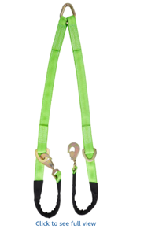
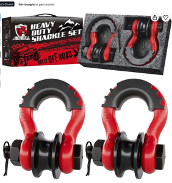

# Field Day Committee Meeting Summary

**Sprint:** Sprint 1 (Issue Triage & Volunteer Recruitment)

**Meeting #:** 2

**Date:** 2026-11-18

**Time:** 8:00 PM PT

**Location:** Zoom

**Facilitator:** Tom Sayles (KE4HET)

**Source:** Compiled from the Zoom transcript and meeting chat. Timestamps below are recording-relative.

## Attendees

- Tom Sayles (KE4HET)
- Ross Van Deen (W7ROV)
- Scott (KC7SAG; displayed as "Mike and Key")
- Robert (KD7WNV)

## Key Outcomes

- Continue with Scott's Google Form and spreadsheet for volunteer signup; Tom's search did not identify a suitable free, open-source replacement.
- Scott volunteered to lead Wagon Wheel coordination, with Ross offering to help.
- Scott will demonstrate volunteer signup at the Saturday, November 21 membership meeting. Tom will prepare a Field Day update and promote the mailing list, planning meetings, and volunteer needs.
- Tom will prepare a comprehensive rotator rehabilitation plan for the December 1 board meeting and circulate it to the Field Day mailing list for review.
- Water-anchor rigging and rotator improvements remain proposals requiring board approval; no equipment purchase was approved during this meeting.

## Discussion Summary

### Volunteer Signup and Leadership (07:44; 34:22-48:22; 54:22-59:20)

Scott revamped the signup categories and spreadsheet layout. Earlier responses did not fit the revised structure, so he removed them and notified previous respondents to resubmit. Volunteers who signed up before the revision should submit their choices again.

Participants tested the form during the call. Ross resubmitted his response, and Scott removed the duplicate. The form provides an "edit your response" link; volunteers should retain that link if they expect to change their answers.

Tom still needs to send Scott the additional jobs and roles missing from the form. Recruitment priorities include the Field Day Director, setup and teardown crews, potluck coordination, and trailer towing. Tow volunteers need suitable vehicles and advance coordination of their camping plans.

The director role remains unfilled. Recruitment should emphasize that the director coordinates and supports the team rather than doing all the work, and that former chairs can provide mentoring. Tom also hopes to interview former chairs to capture their experience for the Field Day playbook ([#43](https://github.com/tsayles/field-day-2027/issues/43)).

### Wagon Wheel and Trailer Arrival (38:31-41:58)

Scott volunteered as Wagon Wheel lead, and Ross offered to assist. Participants described Monday arrivals as only a handful of camping units, with attendance building during the week.

Tom asked about arrival patterns to assess when the equipment trailer and work crews would be useful. No early trailer-arrival date or maintenance workday was agreed; the need for Monday delivery remains unconfirmed ([#23](https://github.com/tsayles/field-day-2027/issues/23)).

### Visitor-Table QR Signage (09:18-14:05)

Scott has generated the Field Day information QR code. Tom will attach or link the supplied artwork to the tracking work. The group favored a simple printed sign, approximately letter size, protected by a plastic sleeve or lamination for the visitor table ([#1](https://github.com/tsayles/field-day-2027/issues/1)).

Robert described the small event posters he places around campground bathrooms and suggested he might be able to make room for a QR code. This was an option, not a firm commitment. Cellular coverage varies within the park, so visitors may not be able to open the destination immediately.

### Water-Anchor Rigging Proposal (14:09-30:05)

Ross researched recovery/bridle straps and pulley/snatch-block hardware to connect existing water bags to guy ropes with less knotting and rope handling ([#14](https://github.com/tsayles/field-day-2027/issues/14)). The proposal reuses the existing bags; it is not a request to replace them.

The initial estimate was approximately $300 for six anchor setups. Less expensive straps could bring the rough estimate toward $200, but quantities, hardware selection, and a final cost still need refinement. These were discussion estimates, not an approved budget.

Tom recommended reducing the cost and/or finding sponsorship. Robert noted that the club has a capital-equipment budget; donations were also discussed. The committee needs a summarized proposal for board consideration. Ross posted product links in chat, and Tom asked him to send his presentation for inclusion in the notes.

**Presentation received after the meeting:** [Ross's original water-anchor enhancement presentation (OpenDocument, .odp)](presentations/2026-11-18-ross-water-anchor-proposal.odp).

Ross's proposed products are linked below. Thumbnails are taken from his presentation; prices are the amounts shown in those slides, not current quotes.

| Proposed product | Thumbnail (opens listing) | Price shown in Ross's slides |
|------------------|---------------------------|-----------------------------|
| [Racewill 2" x 4' V-bridle strap](https://a.co/d/08oVnx8j) |  | $29.99 each |
| [AMBULL snatch block / shackle with pulley, two-pack](https://a.co/d/0drtcCe3) |  | $36.54 per two-pack |

**Post-meeting scope clarification (November 19):** Two towers, with three independent guy-line anchor points per tower and six existing water bags per anchor point: six anchor assemblies and 36 bags total. At the prices in Ross's slides, six bridles plus three two-packs of blocks total $289.56 before tax and shipping. This is purchasing arithmetic, not equipment approval or a load-capacity assessment.

### Rotator Rehabilitation and Cabling (30:10-34:06; 48:30-50:19)

Tom showed aviation-style connectors obtained for the rotator cable rebuild. Following discussion with Daniel, the proposed arrangement uses a panel connector in a box mounted on the tower section below the rotator, allowing easier one-handed connection and tightening.

Ross emphasized that separate strain relief must support the hanging cable's weight rather than leaving that load on the connector; Tom said the existing cables already have cable grips.

Tom plans to rebuild the cables with help from an experienced technician and offered to donate the hardware. He will develop the full off-season rehabilitation plan ([#6](https://github.com/tsayles/field-day-2027/issues/6)) for board review. The discussion did not constitute board approval to modify the equipment.

### Membership Outreach and Communications (44:23-45:07; 50:19-58:05)

At the November 21 membership meeting, Scott will demonstrate the signup workflow and Tom will present a planning update. The appeal should explain the jobs, recruit a director and setup/teardown helpers, and invite members to join the Field Day mailing list and committee Zoom calls.

The group reviewed how to find the Field Day discussion group through the club website. Tom explained that the Monday reminder went to both the general club and Field Day lists, while the same-evening reminder went only to the Field Day list.

## Action Items

Timing is recorded only where stated or tied to a specific meeting; other deadlines were not set.

| Action | Owner | Timing |
|--------|-------|--------|
| Demonstrate the volunteer form and spreadsheet to the membership | Scott | November 21 membership meeting |
| Prepare a Field Day update; promote director recruitment, volunteer signup, the mailing list, and planning calls | Tom | November 21 membership meeting |
| Send Scott the additional jobs and roles needed on the signup form | Tom | Not specified |
| Attach or link Scott's QR artwork to the signage tracking work | Tom | Not specified |
| Prepare the full rotator rehabilitation proposal and circulate it to the Field Day list for review | Tom | For December 1 board meeting |
| Lead Wagon Wheel coordination, with Ross assisting | Scott; Ross supporting | Planning through Field Day 2027 |
| Write and distribute the meeting summary and action items | Tom | After this meeting |

## Open Follow-Ups

- Refine the water-anchor parts list, cost, and funding approach before board consideration; Ross remains the research lead. His original presentation is now linked above.
- Assign responsibility for printing and protecting the visitor-table QR sign.
- Follow up on Tom's proposed former-chair interviews for the playbook; no interview dates were set.
- Confirm trailer-arrival timing against available volunteers.
- The agenda question about publicly posting raw transcripts was not discussed; no publication decision was recorded.

**Next meeting:** Wednesday, December 2, 2026, at 8:00 PM PT. The group confirmed the first/third-Wednesday cadence after clarifying the board meeting is on Tuesday.

## Links

- [Meeting agenda](2026-11-18-meeting-agenda.md)
- [Previous meeting notes](2026-11-04-meeting-notes.md)
- [Meeting schedule](README.md)
- **November 21 membership update:** [Editable Impress slides (.odp)](presentations/2026-11-21-membership-field-day-update.odp?raw=true) | [PDF](presentations/2026-11-21-membership-field-day-update.pdf)
- [Project board](https://github.com/users/tsayles/projects/5)
- [Volunteer signup form shared in chat](https://docs.google.com/forms/d/e/1FAIpQLSdNkSygRRDbv0HmI0SfuBtOZ7w1RTAnQGbve2HpOGIMs1-4OA/viewform)
- [Field Day mailing list](https://mkarc.groups.io/g/FieldDay)
- [Ross's original water-anchor presentation (.odp)](presentations/2026-11-18-ross-water-anchor-proposal.odp)
- [Ross's proposed snatch block / pulley two-pack](https://a.co/d/0drtcCe3)
- [Ross's proposed V-bridle strap](https://a.co/d/08oVnx8j)

Source files: `GMT20261119-035752_Recording.transcript.vtt` and `GMT20261119-035752_RecordingnewChat.txt` in the local November 16 weekly working folder. The raw transcript and unrelated personal conversation are not included here.
